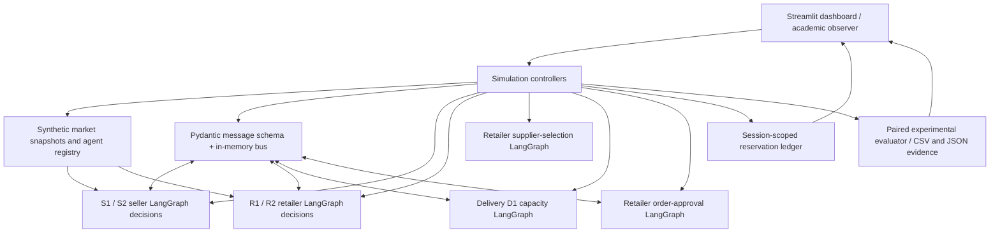
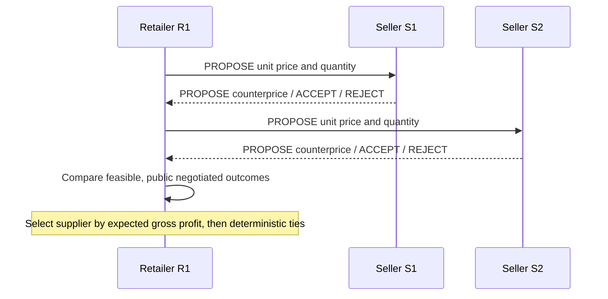
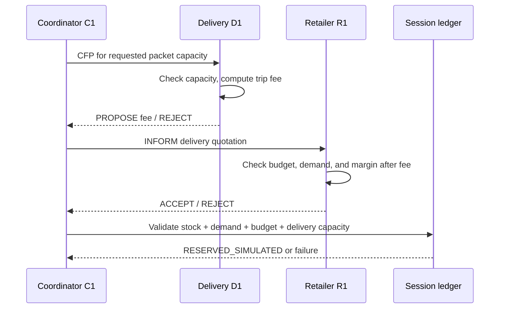

# SMEConnect AI: A LangGraph-Based Multi-Agent System for SME Marketplace Negotiation and Coordination

**Module:** IT6415 – Software Agents and Swarm Intelligence  
**Programme:** MSc in Artificial Intelligence  
**Document status:** Submission draft grounded in implemented repository (Phases 01–05.2); replace the results placeholders with verified local experiment outputs before submission.  
**Study type:** Reproducible synthetic simulation, not a field trial or an AI model-training study.  
**Project repository:** [SME_Connect_MAS](https://github.com/dineshabey/SME_Connect_MAS)

## Abstract

Small and medium enterprises (SMEs) often face difficulties when finding appropriate trading partners, evaluating competing offers and coordinating resource constraints. This project develops **SMEConnect AI**, a local, explainable multi-agent marketplace simulation in which autonomous software agents represent sellers, retailers, a delivery service, a market observer and a coordinator. LangGraph StateGraphs model agent-specific decisions. Pydantic-based FIPA-inspired messages and an in-memory message bus mediate bounded negotiation and coordination.

The prototype supports two seller strategies, two retailers, supplier discovery, bilateral proposal/counterproposal exchanges, retailer-led utility-based supplier selection and simulated stock–budget–delivery reservations. Controlled market snapshots allow experiments with seller stock shortages, input-price pressure and changes in retailer demand. A reproducible paired factorial evaluation measures supplier switching, selection success, negotiated prices, expected gross profit, negotiation rounds and message volume.

**Results disclosure:** Numerical aggregate findings are intentionally not included here until the Phase 05.2 evaluation is executed on the user's local machine. The repository contains the evaluation runner and an evidence-export tool to generate report-ready results. The contribution is a transparent **rule-based MAS prototype**, not a live commerce platform, an online-learning agent or evidence of emergent self-organization.

**Keywords:** Multi-Agent Systems, LangGraph, autonomous agents, negotiation, resource coordination, SME marketplace, synthetic market simulation, adaptation.

## 1. Introduction

A marketplace involves multiple stakeholders with different priorities. A retailer seeks favorable purchasing terms and sufficient stock; a producer seeks acceptable prices or higher sales volume; a delivery provider must respect transportation capacity; and a coordinating service must help participants interact without taking over their decisions. A centralized fixed-rule application can display suppliers but does not inherently demonstrate the independent interests and communication among these participants.

SMEConnect AI investigates how multiple autonomous decision-making entities can negotiate, compete and cooperate within a bounded, observable simulation. The implementation is deliberately small and local for an academic demonstration. Its goal is **demonstrating MAS characteristics with auditable traces**, rather than predicting actual demand or completing real purchases.

### 1.1 Problem statement

How can an explainable, locally executable multi-agent system model distinct commercial interests, negotiate purchasing terms, select a suitable supplier and coordinate simulated stock, budget and delivery resources while responding to controlled market changes?

### 1.2 Objectives

1. Define separate software agents with agent-specific goals, strategies and constraints.
2. Implement explicit, validated inter-agent proposal and response communication.
3. Demonstrate bounded seller–retailer negotiation and independent retailer supplier selection.
4. Coordinate a simulated resource reservation subject to stock, demand, budget and delivery limits.
5. Test agent responses to synthetic changes in stock, demand and pricing.
6. Evaluate selected measurable behaviors using reproducible experiment configurations and traces.

### 1.3 Scope

The demonstration handles one synthetic item, **roasted peanuts in 100g packets**, and a fixed synthetic actor registry. Public example asking prices are distinct from negotiated prices. The simulator does not connect to genuine SMEs or expose real personal/business data. Its reservations are provisional in-memory allocations; no physical deliveries, real payments or durable inventory changes occur.

## 2. Related Concepts and Design Rationale

A **software agent** is modeled here as an entity with its own role, objective, accessible observations, private constraints and decision policy. **Autonomy** is evidenced when sellers and retailers use their respective LangGraph decision graphs rather than a coordinator issuing price decisions. **Social ability** appears in the FIPA-inspired performatives (e.g. PROPOSE, ACCEPT-PROPOSAL, REJECT-PROPOSAL, CFP, INFORM) carried by the validated message bus. **Reactivity** appears when the same decision policies receive changed scenario state. **Competition** is represented by independent seller negotiations; **cooperation** by the delivery and reservation workflow.

This project employs deterministic and explainable rules, not an LLM's hidden chain of thought. The dashboard's “Agent Thinking” descriptions summarize implemented constraints or event explanations rather than providing private internal thoughts. LangGraph provides an explicit StateGraph orchestration layer; Pydantic validates message payloads; Streamlit visualizes the actual event traces.

These design choices favor traceability, bounded computational cost and privacy separation for the educational setting.

## 3. System Design and Architecture

### 3.1 Agent roles and responsibilities

| Agent | Instances | Goal / strategy | Observable action |
|---|---|---|---|
| Seller | S1 | Protect margin; firm pricing | Evaluate, accept, reject or counteroffer |
| Seller | S2 | Prioritize sales volume; bulk pricing | Evaluate, accept, reject or counteroffer |
| Retailer | R1 | Reduce purchasing cost | Propose, assess affordability/profit and choose supplier |
| Retailer | R2 | Meet demand within constraints | Negotiate with its own budget/price/demand constraints |
| Delivery | D1 | Quote a feasible synthetic trip | Check available capacity and propose fee |
| Market | M1 | Observe controlled scenario signals | Send public market INFORM signal |
| Coordinator | C1 | Discover agents and facilitate coordination | Return seller IDs; validate and request reservations |

The coordinator **does not decide the selected supplier or override sellers' confidential minimum prices**. The retailer's selection graph compares public negotiation outcomes.

### 3.2 System component diagram



### 3.3 Negotiation interaction



Negotiations are separate bounded **sequential simulations**, not parallel distributed negotiations. Each generates an independently identified conversation and trace of validated messages. An agreement is a provisional price agreement, not a purchase.

### 3.4 Supplier-selection decision

For negotiated unit price `p`, expected resale price `r` and quantity `q`:

```text
Purchase cost = p × q
Expected gross profit = (r − p) × q
```

The retailer evaluates candidates that have an actual negotiated agreement and satisfy its maximum unit price, available budget and positive expected gross profit. The highest expected gross profit wins. In a tie, fewer negotiation rounds and then seller ID determine the result. Unsuccessful negotiations are not treated as supplier agreements.

### 3.5 Delivery and reservation coordination



The synthetic reservation ledger checks **all** relevant constraints before mutating a sequential session ledger. This limits double allocation in the local, single-session simulation. It is neither an ACID database nor safe for concurrent production orders. `RESERVED_SIMULATED` does not imply shipment, delivery or payment.

## 4. Implementation

**Language and components:** Python, LangGraph, Pydantic, Streamlit and pytest. No paid model/API is required.

**Core modules:** `smeconnect/agents/` for role definitions; `smeconnect/graphs/` for typed StateGraphs; `smeconnect/communication/` for validated messages and transport; `smeconnect/environment/` for synthetic market state and catalogue; `smeconnect/simulation/` for negotiation, selection, coordination and experiments; `dashboard/` for observable teaching views.

**Representative starting constraints:** S1 has synthetic stock 500, S2 stock 300, R1 demand 200 and budget Rs.35,000, D1 capacity 400 and one-trip fee Rs.1,000. These are demonstration assumptions, not empirical measurements. Seller-private minimum/target prices are not included in public listing projections or experiment exports.

## 5. Experimental Design

### 5.1 Research questions

- **RQ1:** Does reduced supplier availability change retailer supplier selection?
- **RQ2:** Does private seller pricing pressure affect acceptance and supplier choice?
- **RQ3:** Can increased retailer demand leave the preferred supplier unchanged for a fixed order?
- **RQ4:** How do selection success, expected gross profit and message volume vary across market scenarios?

### 5.2 Independent variables and controls

The Phase 05.2 evaluator uses the fixed Cartesian grid below. A **paired trial** means identical negotiation settings applied to two independent agent snapshots: normal and shocked. There is no live market sampling and no stochastic policy.

| Factor | Default values |
|---|---|
| Market condition | S2 stock shortage; S2 price pressure; R1 demand surge |
| Quantity | 100 and 200 packets |
| Initial retailer offer | Rs.140; Rs.150; Rs.160 |
| Retailer | R1 |
| Retailer preferred price | Rs.150 |
| Maximum negotiation rounds | 5 |
| Baseline | Normal synthetic market |

The default grid contains **3 × 2 × 3 = 18 paired trials**, corresponding to **36 independent supplier-selection executions**. In each execution, the two seller negotiations proceed separately. All outcomes must be taken from the runner, not manually invented.

### 5.3 Dependent variables

| Metric | Operational definition |
|---|---|
| Supplier selection rate | Share of trials with a feasible selected seller |
| Supplier switch rate | Share of pairs where selected supplier ID differs before/after, including NONE |
| Mean selected unit price | Average agreed price among selected suppliers, if any |
| Mean expected gross profit | Average expected gross profit, including 0 where no supplier selected |
| Average message volume | Recorded seller–retailer messages per trial over both negotiations, excluding M1 notification |
| Average negotiation rounds | Sum of bilateral negotiation rounds in a trial, averaged across trials |
| Seller agreement rate | Percentage of individual seller negotiation runs ending with AGREED |

Expected gross profit excludes delivery and operating overhead, so it must not be described as net profit. Evaluation runs do not perform simulated reservations; Phase 04 separately demonstrates delivery fee inclusion and reservation constraints.

### 5.4 Reproduction procedure

```powershell
git pull origin main
python -m pytest -q
python -m smeconnect.simulation.export_evidence --out-dir evaluation_output
python -m streamlit run dashboard/app.py
```

Record Python version, package versions, revision/commit identifier, test result and the generated experiment configuration. A no-seed deterministic grid is appropriate for this fixed-rule model; it does not support confidence intervals or inferential claims about real SME populations.

## 6. Results — Verification Required

**Status at report drafting:** The experimental evaluation runner is implemented and synthetic scenario outcomes can be generated. **Complete aggregate results have not been independently executed and verified in this report-writing environment.** Do not submit placeholder values as measured outcomes.

After the local evidence export runs, copy the generated `evaluation_output/RESULTS_FOR_REPORT.md` section here.

| Metric | Normal market | Changed market | Difference |
|---|---:|---:|---:|
| Supplier selection rate | *Insert measured value* | *Insert measured value* | *Compute from evidence* |
| Mean expected gross profit | *Insert measured value* | *Insert measured value* | *Compute from evidence* |
| Average negotiation messages | *Insert measured value* | *Insert measured value* | *Compute from evidence* |
| Supplier switch rate | — | *Insert measured per-scenario rates* | — |

**Expected illustrative case, not aggregate experimental evidence:** For R1 purchasing 200 packets at an initial offer Rs.150, the normal scenario can select S2 at Rs.150, whereas a synthetic S2 stock shortage (300 → 100) can make S1 the feasible choice at Rs.155. Such expected behavior must be confirmed against actual run output before it is labeled “observed.”

### 6.1 Interpreting actual findings

When results are available, report which scenarios cause supplier changes, which do not, whether price and expected gross profit trade off, and whether negotiation message counts increase or decrease. Explain outcomes by connecting them to each agent's documented constraints. Preserve all zero/no-agreement trials when computing selection rates and average gross profit; otherwise metrics become optimistically biased.

## 7. Discussion and MAS Evidence

**Autonomy:** Seller and retailer decision graphs execute their own acceptance, rejection and counteroffer policies. **Competition:** Independent sellers negotiate over the same retailer request. **Social interaction:** Validated FIPA-inspired message histories demonstrate communication. **Cooperation and coordination:** Delivery and retailer independently decide on capacity and affordability, with a coordinator applying a bounded, all-or-none simulated reservation. **Reactivity:** Market scenarios change environment state, and the existing policies recompute decisions.

**Critical distinction:** The experiment demonstrates **rule-based response to controlled input changes**, not learned adaptation, collective intelligence, evolutionary behavior or emergent self-organization. Supplier switching can result directly from predefined stock or price constraints; it is insufficient alone to claim emergent behavior.

A central simulation driver orchestrates sequential turns. Thus this design demonstrates **decentralized decision ownership within a centralized in-memory experimental scheduler**, not a fully distributed deployment.

## 8. Testing, Threats and Limitations

Tests are intended to cover negotiation acceptance/rejection, bounded rounds, seller discovery, privacy boundaries, alternative market states, deterministic comparative metrics, delivery capacity, insufficient budget, duplicate resource reservation and rejection without partial allocation. Record the actual `pytest` summary before reporting a total passing count.

**Validity threats:** (1) Synthetic inputs cannot establish external validity for real SME markets; (2) two sellers and one product limit marketplace diversity; (3) preset rules and small finite scenario grids do not establish learning or statistical generalization; (4) negotiation rounds and messages are **not** wall-clock latency; (5) expected gross profit excludes logistics cost in Phase 05 evaluations; (6) no geographically grounded transport routing or dynamic delivery tariff; (7) in-memory sessions are not concurrency-safe; (8) no real-world users or independent usability study.

**Security/privacy:** Seller private reservation prices are not disclosed in public listings or exported experiment summaries. FIPA-inspired messages are schema-validated and attributed in the simulation; the architecture does not claim production-grade authentication, durable audit trails or immunity to all malicious payloads.

## 9. Conclusion and Future Work

SMEConnect AI provides a compact and inspectable case study of multiple agents making independent economic decisions, negotiating via typed messages and coordinating bounded resources in a local synthetic marketplace. Its reusable market snapshot and paired evaluation design allow controlled comparison of rule-based agent responses to stock, demand and price changes. Its educational value lies in the explicit distinction between true recorded agent actions and visual/academic interpretation.

Possible future work includes multiple products, more competing retailers and delivery agents, delivery routing, concurrent reservation testing, agent memory/learning, genuine but consented SME datasets, empirical user evaluation and rigorous measures of emergent coordination. These remain **future objectives**, not implemented findings.

## Appendix A — Evidence and submission checklist

- [ ] Record Git revision and package versions used for the evaluation
- [ ] Save `pytest` output showing the actual result
- [ ] Run the 18-pair experiment grid and preserve CSV/JSON evidence
- [ ] Insert the generated measured-results table into Section 6
- [ ] Capture screenshots of supplier competition, delivery reservation, market shock, evaluation dashboard
- [ ] Confirm all figures are labeled *synthetic simulation*
- [ ] Confirm no private seller pricing appears in public export
- [ ] Rehearse the companion `docs/FINAL_DEMO_SCRIPT.md`
- [ ] Follow department-specific cover-page, word-count, citation and originality requirements

## Appendix B — Source of implementation details

This draft is derived from the repository source, design documents and current Python interfaces for Phases 02–05.2. Additional academic citations may be required by the course rubric. Do **not** fabricate external literature references: add reviewed sources that were actually read and used.

