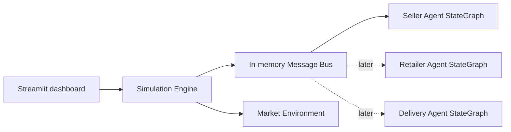

# Architecture reference

## Design notes
- The coordinator facilitates message routing, not commercial decisions.
- Agent private limits should be isolated in agent-specific state.
- Version 0.1 only has seller offer evaluation. Future versions add agent-to-agent negotiation rounds and delivery.
- Adapted organization principles from AEE-Bootcamp Week 10 (agents/state/orchestration separation); not copied code.
