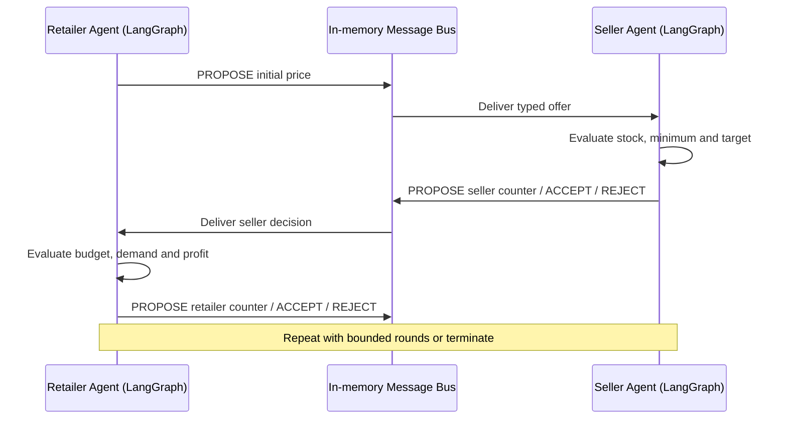

# SMEConnect AI — Architecture and Execution Status

## Phase 02: Two-way autonomous agent negotiation



## Module boundaries

- `smeconnect/agents/` defines distinct agent instances and private constraints.
- `smeconnect/graphs/seller_graph.py` owns the seller's LangGraph pricing decision.
- `smeconnect/graphs/retailer_graph.py` owns retailer financial analysis and bounded concessions.
- `smeconnect/communication/message_schema.py` validates typed FIPA-inspired messages.
- `smeconnect/communication/message_bus.py` transports the messages and records the history.
- `smeconnect/simulation/negotiation.py` runs a bounded, event-driven interaction and records its actual messages.
- `dashboard/app.py` displays the genuine trace as an animated negotiation; it does not decide prices.

## What works versus what is still planned

**Implemented in code:** Separate seller/retailer StateGraphs; explicit proposals and responses; agent-specific limits; finite maximum rounds; recorded messages; outcome status `AGREED`, `REJECTED`, or `MAX_ROUNDS`; Streamlit animation driven by those recorded events.

**Still planned / not verified:** Live external buyer discovery; delivery coordination; atomic inventory reservations; actual order/payment settlement; durable event persistence; full message origin authentication for arbitrary callers; comprehensive experiments and self-organization measures.

**Important:** `AGREED` means a **provisional agreement on unit price**, not a completed commercial transaction. The demonstration uses synthetic market data. The architecture documents intended security boundaries in [TRUST_BOUNDARIES.md](../TRUST_BOUNDARIES.md) and STRIDE risks in [STRIDE_THREAT_MODEL.md](STRIDE_THREAT_MODEL.md).

## Running locally

```powershell
python -m pytest -q
python -m streamlit run dashboard/app.py
```

The dashboard provides standalone seller and retailer tests plus an animated two-agent negotiation example. The animation replays recorded messages, and the demonstration remains offline and free of paid APIs.
