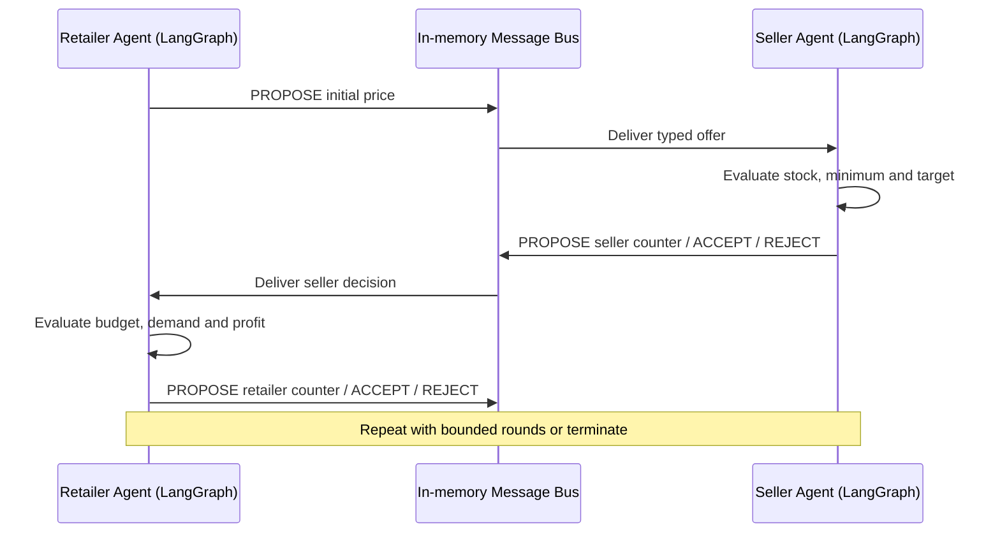
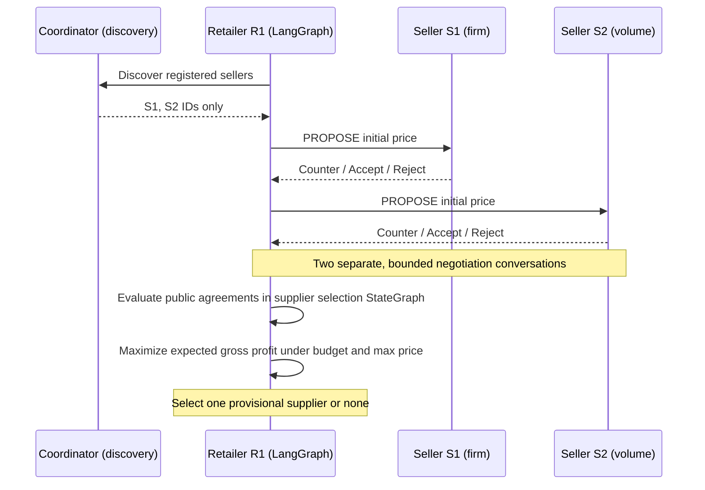

# SMEConnect AI — Architecture and Execution Status

## Phase 02: Two-way autonomous agent negotiation



## Module boundaries

- `smeconnect/agents/` defines distinct agent instances and private constraints.
- `smeconnect/graphs/seller_graph.py` owns the seller's LangGraph pricing decision.
- `smeconnect/graphs/retailer_graph.py` owns retailer financial analysis and bounded concessions.
- `smeconnect/communication/message_schema.py` validates typed FIPA-inspired messages.
- `smeconnect/communication/message_bus.py` transports the messages and records the history.
- `smeconnect/simulation/negotiation.py` runs a bounded, event-driven interaction and records its actual messages.
- `dashboard/app.py` displays the genuine trace as an animated negotiation; it does not decide prices.

## What works versus what is still planned

**Implemented in code:** Separate seller/retailer StateGraphs; explicit proposals and responses; agent-specific limits; finite maximum rounds; recorded messages; outcome status `AGREED`, `REJECTED`, or `MAX_ROUNDS`; Streamlit animation driven by those recorded events.

**Still planned / not verified:** Live external buyer discovery; delivery coordination; atomic inventory reservations; actual order/payment settlement; durable event persistence; full message origin authentication for arbitrary callers; comprehensive experiments and self-organization measures.

**Important:** `AGREED` means a **provisional agreement on unit price**, not a completed commercial transaction. The demonstration uses synthetic market data. The architecture documents intended security boundaries in [TRUST_BOUNDARIES.md](../TRUST_BOUNDARIES.md) and STRIDE risks in [STRIDE_THREAT_MODEL.md](STRIDE_THREAT_MODEL.md).

## Running locally

```powershell
python -m pytest -q
python -m streamlit run dashboard/app.py
```

The dashboard provides standalone seller and retailer tests plus an animated two-agent negotiation example. The animation replays recorded messages, and the demonstration remains offline and free of paid APIs.

## Phase 03: Multi-seller competition and retailer-owned supplier selection



The coordinator only lists discovered seller identifiers: it does not inspect seller minimum prices or decide the winner. `run_supplier_competition()` uses each seller's existing LangGraph negotiation separately, then supplies **public outcomes** to `build_supplier_selection_graph()`.

Seller S1 retains its margin-focused pricing policy. Seller S2 has a **documented simulated bulk-volume policy**: for orders of 100 or more packets, it accepts offers at least Rs.10 above its private minimum, if stock permits. This gives the experiment two distinct autonomous seller strategies rather than hard-coding a winning supplier.

The retailer compares feasible agreements using expected gross profit `(expected retail price - negotiated purchase price) × requested quantity`, subject to its budget and maximum price. Ties are resolved by fewer negotiation rounds and seller ID.

The Streamlit **Phase 03 · Supplier Competition** tab displays the three-agent network, compares actual outcome records, shows the retailer's decision reason, and replays the recorded conversation with each seller using the existing neon visualization.

**Important limitations:** Discovery uses in-memory registered agents, not real buyer discovery or an external API. Negotiations run as separate bounded simulations rather than simultaneous distributed processes; there is no shared stock reservation. Supplier selection is provisional, no real business transaction occurs, and self-organization has not yet been experimentally demonstrated.

## Phase 03.1: Public Seller Marketplace

A new `smeconnect/environment/catalogue.py` contains **synthetic public product listings** for the currently supported product `roasted_peanuts_100g`. Each listing includes seller ID, product label, advertised asking price, advertised stock, broad strategy and currency. **Private seller minimum and target prices remain in seller agent state and are never added to the public catalogue.**

Public example asking prices: S1 Rs.175 and S2 Rs.165 per 100g packet. These are deliberately **not the negotiated agreement prices**.

`dashboard/marketplace_viz.py` provides a Marketplace tab with seller cards, search, public prices, stock display, retailer and seller selection, and a **Discover & negotiate** action. The action filters sellers with insufficient advertised stock and invokes the existing `run_supplier_competition()`, then compares public asking prices against recorded negotiated prices and shows the actual agent messages.

**Scope limit:** one synthetic product is currently wired to the negotiation message schema. This is a demo catalogue, not a live SME database or production inventory. Public asking prices are currently fixed scenario values. The catalogue does not place orders, reserve inventory, deduct budgets or check delivery capacity; those require Phase 04.

## Phase 04 — Multi-agent delivery coordination and simulated resource reservation

The **Delivery Coordination** tab builds on Phase 03 negotiation and supplier selection. It selects one provisional negotiated supplier, checks the seller's remaining stock, and sends a FIPA-inspired `CFP` to **Delivery Agent D1**. D1 has an independent `delivery_graph.py` LangGraph decision workflow: it checks remaining capacity and quotes a synthetic trip fee (Rs.1,000 for D1). The **Retailer Agent** then executes `retailer_order_graph.py` to approve or reject the negotiated purchase **including delivery cost**.

If the seller has stock, delivery capacity is available, the retailer has enough demand and budget, and expected margin after delivery is positive, the Coordinator asks `ReservationLedger.reserve()` to allocate **seller stock, retailer budget, retailer demand and delivery capacity together**. Every constraint is validated before the ledger mutates, preventing partial allocations or double-booking inside one sequential simulation session. The result is `RESERVED_SIMULATED`, not delivered, paid, or dispatched.

**Example scenario (R1, 200 packets):** Seller S2 may agree to Rs.150/packet, creating Rs.30,000 purchase cost. D1 quotes Rs.1,000, so R1 approves Rs.31,000 total against its Rs.35,000 budget and expects Rs.9,000 margin after delivery under the simulated Rs.200 resale assumption. The ledger reserves 200 packets of S2 stock and D1 capacity, 200 packets of R1 demand, and Rs.31,000 of budget.

**Transparency and limits:** Message traffic is recorded in an in-memory typed bus; private seller reservation prices are not sent to other agents. The orchestrator records separate non-message decision events with reasons. All values are synthetic, the delivery quote is a simple per-trip cost, and the order ledger is scoped to the current Streamlit session. It is sequential only—**not** an ACID database or a concurrent-safe transaction manager. There is no actual payment, shipment, delivery routing, seller fulfillment, network outreach, or persistent inventory update.

**Verify locally:**

```powershell
python -m py_compile dashboard/app.py dashboard/delivery_viz.py smeconnect/simulation/fulfillment.py smeconnect/simulation/reservation_ledger.py smeconnect/graphs/delivery_graph.py smeconnect/graphs/retailer_order_graph.py
python -m pytest -q
python -m streamlit run dashboard/app.py
```

## Phase 05.1 — Dynamic market snapshots and Market Agent signals

`smeconnect/environment/market_state.py` defines bounded, synthetic scenarios: normal; S2 stock shortage (S2 drops to 100 packets); S2 input-price pressure (seller's **private** minimum and target adjust internally); and R1 demand surge (200 → 240 packets). Scenario inputs create **new agent instances** via `build_agents(market_state)`, rather than mutating globally configured agents.

`smeconnect/simulation/market_experiment.py` runs independent normal/changed comparisons through the **existing LangGraph seller/retailer negotiation engine and retailer supplier-selection graph**. Market Agent M1 observes a limited public market signal and sends a Pydantic-validated `INFORM` message to the selected retailer through the existing in-memory bus. The retailer does **not** receive sellers' private minimum/target prices. The market signal is an observable informational message; the scenario state is what changes the agents' negotiation inputs.

The Streamlit `📈 Phase 05 · Market Adaptation` tab shows scenario selection, M1's typed market notification, public stock/demand before vs. after, actual supplier outcomes, negotiated price changes and raw evidence. A supplier change is **not hard-coded**; S2 may reject a 200-packet order after stock shortage, leaving S1 feasible. Demand surge can also leave the same supplier selected, demonstrating that adaptation does not guarantee a changed winner.

**Limits:** no live market data, external messages or autonomous sensing. These are predetermined counterfactual scenarios and **rule-based responses to changed inputs**, not online learning or verified emergent self-organization. Experiments do not reserve stock or budgets, and they do not modify the independent Phase 04 session ledger. The Marketplace catalogue still shows its normal static listings rather than scenario-specific values.

**Run locally:**

```powershell
python -m py_compile smeconnect/environment/market_state.py smeconnect/environment/marketplace.py smeconnect/simulation/market_experiment.py dashboard/market_experiment_viz.py dashboard/app.py
python -m pytest -q
python -m streamlit run dashboard/app.py
```

## Phase 05.2 — Reproducible experimental evaluation

`smeconnect/simulation/experiment_evaluation.py` runs a bounded, deterministic **factorial grid** of paired counterfactual market simulations using the existing Phase 05.1 `run_market_experiment()`. Each pair repeats the exact same order quantity, first offer, preferred price and round limit, changing only the synthetic market scenario.

Default evaluation: three shocks (`s2_shortage`, `price_pressure`, `demand_surge`), two quantities (100 and 200 packets), three initial offers (Rs.140, Rs.150 and Rs.160), retailer R1, target Rs.150, maximum five rounds. Thus **18 paired comparisons / 36 supplier-selection runs**, each with up to two independent seller negotiation conversations. Maximum 36 pairs to bound execution. This is a deterministic parameter sweep: it is **not** a statistical random sample and no random seed is needed. Conversation UUIDs do not enter aggregate outcomes.

### Measurement definitions

- **Supplier selection rate:** paired-trial sides with any selected supplier / total trials.
- **Supplier switch rate:** count of paired trials where selected seller ID differs before versus after / total pairs, including transitions to or from no agreement.
- **Expected gross profit:** average scenario-model gross profit over all trials; zero for no supplier. The synthetic gross profit excludes delivery fees and overhead.
- **Average selected unit price:** mean price over trials that resulted in a selection only; undefined (`None`) when there were no selections.
- **Average message volume:** count of actual seller/retailer negotiation bus messages from both seller conversations per side, divided by trial count; excludes M1 informational signal.
- **Average negotiation rounds:** sum of per-seller negotiation rounds per trial, averaged over trials. This is not wall-clock runtime or simultaneous execution.
- **Seller agreement rate:** individual seller negotiation conversations with `AGREED` / all seller negotiations.

`dashboard/experiment_evaluation_viz.py` adds **🧪 Phase 05.2 · Experiments**, with experiment-grid controls, measured summary cards, per-scenario comparison, a bar chart, individual trial inspection, and downloadable CSV / JSON derived only from public outcomes and aggregated diagnostics.

### Scientific limitations and reproducibility

This is **controlled synthetic simulation evidence**, not proof of real-market accuracy, online policy learning or emergent self-organization. Scenario inputs and agent policies are predefined. Runs do not mutate the Phase 04 session reservation ledger or initiate orders. Re-running the same grid should return identical aggregate metrics, although randomly generated conversation IDs would differ outside the exported metrics.

No production agent authentication, concurrent booking, persistent storage or real-time market feeds are included.

Local verification:

```powershell
python -m py_compile smeconnect/simulation/experiment_evaluation.py dashboard/experiment_evaluation_viz.py dashboard/app.py
python -m pytest -q
python -m streamlit run dashboard/app.py
```
